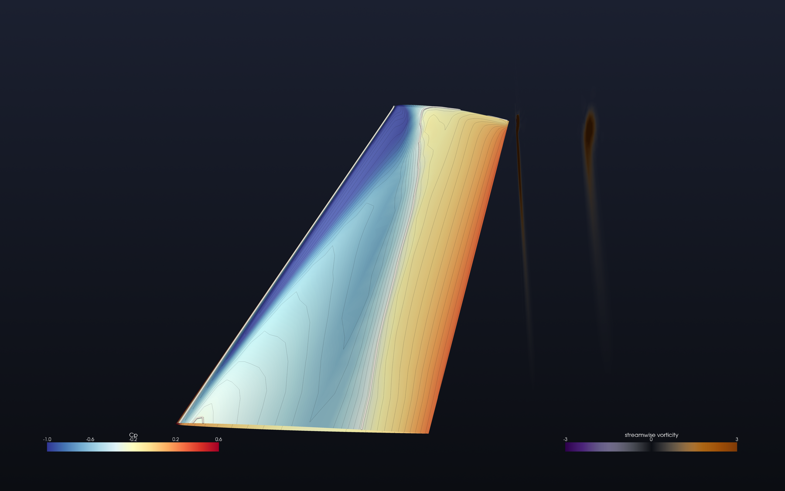
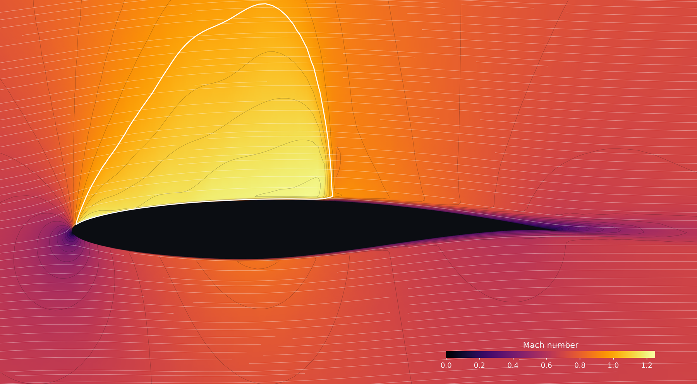
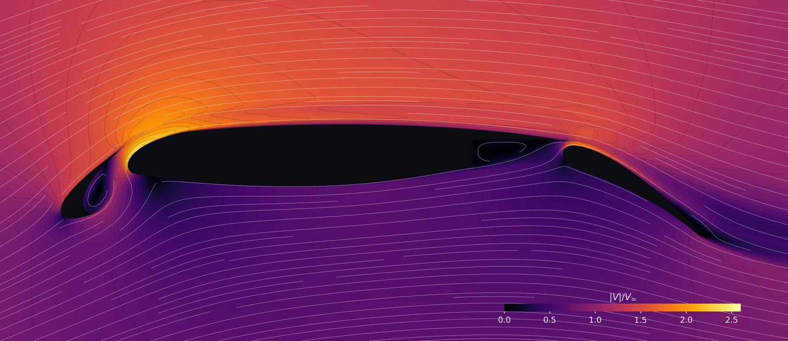

# JAX-Aero

Jaxaero is a Computational Fluid Dynamics solver written in Jax, conceived for steady 2D and 3D flow solutions over airfoil and wings, on structured meshes.
It implements the numerical solution of compressible Euler, laminar Navier-Stokes and RANS equations (Spalart-Allmaras turbulence model) with a
cell-centred finite-volume method on structured grids, in double precision,
on CPU or GPU.

It is conceived as a research code on differentiable, GPU based solvers written in Python. It has been developed with the use of Claude Code. It has been validated on several canonical cases, against existing solvers and experimental data ([validation/gallery](validation/gallery/README.md)). 

In 2D, it supports automatic structured mesh generation around an airfoil from its coordinate file. Alternatively, an input mesh can be provided (Plot3D or CGNS, one block or many). Multi-element high lift sections can be simulated as well, provided that a multi-block structured mesh is provided as input.
For a 3D wing, a one-block Plot3D grid
([docs/wing-3d.md](docs/wing-3d.md)) must be provided.

To launch a new case two config JSON files must be provided so you don't write any code. 


## Install

```bash
pip install -e ".[plot,cgns]"
```

For a GPU, install jax with CUDA support first
([instructions](https://docs.jax.dev/en/latest/installation.html)).

## Run an existing example

```bash
jaxaero examples/naca0012_euler
python -m jaxaero.plot examples/naca0012_euler/results/naca0012_euler
```

## Run your own airfoil

1. Make a directory with your coordinate file (Selig or Lednicer `.dat`, as
   downloaded) and copy `case.json` and `numerical.json` from
   `examples/clarky_sa`.
2. Set `domain.airfoil` to your file name, and set the freestream.
3. `jaxaero my_airfoil --check` to see the grid, then `jaxaero my_airfoil`.

The full walkthrough is [docs/own-airfoil.md](docs/own-airfoil.md). For a
slat-main-flap section or any grid from your own mesher, see
[docs/multi-element.md](docs/multi-element.md).

## Documentation

- [Running a case](docs/guide.md): examples, command line, output, polars, boundary conditions
- [Your own airfoil](docs/own-airfoil.md), [a multi-element airfoil](docs/multi-element.md) and [a 3D wing](docs/wing-3d.md)
- [Case reference](docs/case_reference.md): every key of the two files
- [Equations and method](docs/theory.md)
- [Developer guide](docs/developer.md)
- [Validation](validation/README.md)

`mkdocs serve` (after `pip install -e ".[docs]"`) shows the docs as a website.

## Gallery



**ONERA M6 wing**, SA RANS, M 0.84, alpha 3.06 deg, Re 14.6 million (NASA TMR
case 2308). 1,081,344 cells;
57 minutes on one NVIDIA A100, 2,520 iterations.



**RAE 2822 transonic airfoil**, SA RANS, M 0.729, alpha 2.31 deg, Re 6.5
million (AGARD case 6): Mach number. 23,552 cells; 55 s on one NVIDIA A100, 760 iterations.



**30P30N slat, main element and flap**, SA RANS, M 0.17, alpha 5.5 deg, Re 1.71
million (JAXA's 117-block grid): 63,957 cells; 7
minutes on one NVIDIA A100 (8,000 iterations).

## Repository

```
src/jaxaero/   the solver
docs/          documentation
examples/      example cases
validation/    cases against published data, reference data, gallery
tests/         unit, verification and validation tests
scripts/       benchmark and cluster job scripts
data/grids/    downloaded grid files (not tracked; see its README)
```

Licensed under the GNU GPL v3.
