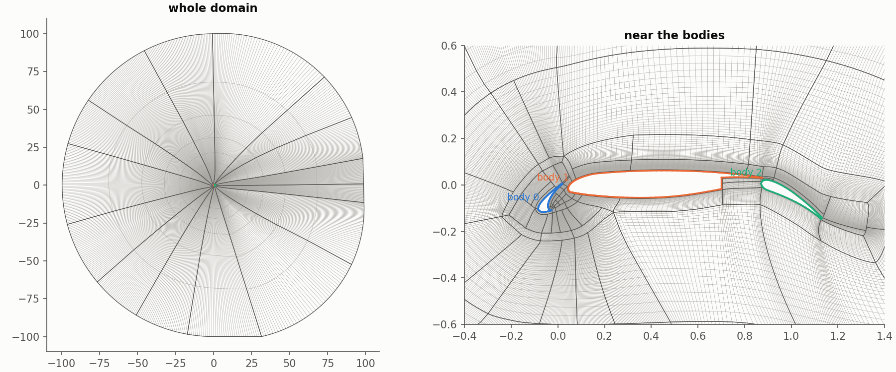
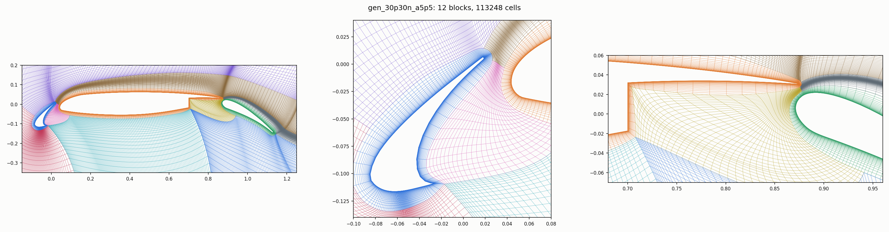

# A multi-element airfoil

For a slat, main element and flap the solver can generate the grid
(`"grid": "multi_element"`, [below](#generated-grids)); for any other
geometry with coves and gaps, make a structured multi-block grid with your
mesher and point the case at the file. The worked
example is `examples/30p30n_sa`: the 30P30N three-element airfoil on JAXA's
117-block grid (download instructions in `data/grids/README.md`).

## 1. What the grid file must be

- **Format**: Plot3D (any variant: formatted or binary, single or double
  precision, 2D, or 3D with one plane used) or CGNS saved in HDF5. Pointwise,
  ICEM CFD and most structured meshers write one of these.
- **Blocks meet node to node.** Interfaces are found by matching coincident
  block faces, so no connectivity file is needed, but the nodes on both sides
  of an interface must coincide. Non-matching (patched) interfaces are not
  supported.
- **Every wall closes round its body**, and the outer boundary closes round
  everything.

In a CGNS file, boundary names come from the file (family names, else BC
types). Plot3D has no names, so faces that are not interfaces are named by
the loop they lie on: the outer loop becomes `farfield`, and each closed loop
round a body becomes `wall`. For other cases, such as a symmetry plane,
an inflow or an outflow, name faces with box rules in `domain.patches`
(the flat-plate example does this).

## 2. case.json

```json
{
    "general": {"case_name": "30p30n_sa"},
    "domain": {
        "grid": "file",
        "file": "data/grids/2Ddomain_L1_coarse_r1.p3d",
        "coordinate_scale": 0.05555555555555555
    },
    "freestream": {"mach": 0.17, "alpha_deg": 5.5, "reynolds": 1.71e6, "temperature": 295.56},
    "material_properties": {"dynamic_viscosity": "sutherland", "sutherland_temperature": 110.4},
    "turbulence": {"model": "sa_noft2"}
}
```

**Units.** The solver works in the length your Reynolds number is based on,
and the force coefficients use the same length. JAXA's grid is in inches,
with an 18 inch stowed chord, so `coordinate_scale` is 1/18. If your grid is
already in chords, leave it out. If you would rather keep the grid as it is
and quote coefficients per some other length, set `reference_length`; the
Reynolds number is then per that length too.

The pitching moment is taken about (0.25, 0) in the scaled coordinates.

## 3. Check the grid

```bash
jaxaero examples/30p30n_sa --check
```

```
grid file 2Ddomain_L1_coarse_r1.p3d: 117 block(s), 63957 cells, 3 body(ies); implicit, hllc, limiter van_albada
grid quality: 63957 cells, min area 8.64e-10, min angle 34.4 deg, max growth 2.16, ...; far field >= 97.6 from the walls
  warning: neighbouring cells growing by up to 2.16x (over 1.5)
patch 'wall': no_slip_wall, 610 faces
patch 'farfield': far_field, 560 faces
body 0: x -0.0848 to 0.0188, y -0.1162 to 0.0066, 266 wall faces
body 1: x 0.0438 to 0.8741, y -0.0546 to 0.0619, 254 wall faces
body 2: x 0.8714 to 1.1307, y -0.1460 to 0.0218, 90 wall faces
```

Look at three things. The number of bodies should be the number of elements:
if it is lower, a wall did not close, usually because two blocks meet with
nodes that do not coincide. The body extents should be in chords. And
`grid.png` should show every element outlined in its own colour:



Bodies are numbered by their leading edge, from the front: here slat 0,
main 1, flap 2.

## 4. Run

```bash
jaxaero examples/30p30n_sa
```

Use the implicit solver with `van_albada`; high-lift flows at low Mach
number converge slowly, so give it several thousand iterations (8000 here).
The coarsest 30P30N level (63,957 cells) runs its 8000 iterations in 7
minutes on an A100 (49 ms each); its forces keep moving by a little more
than the `forces_tol` bar, so it does not stop earlier. On a small GPU, run
a grid of this size on a cluster instead. Its block sizes are odd, so
`grid_sequencing` refuses it.

The forces are printed for the whole configuration and for each body. On
this coarsest level, at 5.5 degrees:

| | CL | CD |
|---|---|---|
| slat (body 0) | 0.151 | -0.065 |
| main (body 1) | 2.183 | -0.135 |
| flap (body 2) | 0.453 | 0.259 |
| total | 2.787 | 0.059 |
| JAXA's RANS, for comparison | 2.877 | 0.040 |

On the third grid level (261 thousand cells) the lift comes within 0.03 %
of JAXA's. Per-element drag is the difference of large pressure forces and
depends strongly on the grid.

`*_surface.dat` lists Cp and Cf body by body, each starting from its
trailing edge, with a `body` column to tell them apart.

## When the grid is refused

- *a face coincides with more than one other face*: two blocks overlap, or
  a block is duplicated in the file.
- *block k folds over*: that block has cells of both orientations; fix it in
  the mesher.
- *no boundary condition for patch(es) [...]*: the file names a boundary the
  case does not mention, and the name has no default. Add it to
  `boundary_conditions`; the message lists the grid's patch names.
- *a 1-to-1 interface the file declares is not matched*: a CGNS file says two
  faces connect, but their nodes do not coincide.

## Generated grids

`"grid": "multi_element"` builds the multi-block grid of a slat, main element
and flap from their coordinates alone, in about a minute on a CPU. The
examples are `examples/main_flap_sa` (the 30P30N without its slat, one file
per element) and `validation/cases/gen_30p30n_a5p5` (the full 30P30N from
one curve file).

### When it applies

- **The arrangement**: a main element with a flap behind it, a slat ahead of
  it, or both (`main`+`flap`, `slat`+`main`, `slat`+`main`+`flap`, listed
  front to back), each trailing edge over the nose of the element behind it,
  as deployed in a single-slotted high-lift section. Not covered: two slats
  or two flaps (double- and triple-slotted systems), Krueger flaps, vanes,
  tabs, or elements side by side; for those, mesh with your own tool and use
  `"grid": "file"`.
- **Each element** a closed contour that does not cross itself or another
  element. Sharp or blunt trailing edges (a blunt base of any thickness),
  smooth or stepped coves, a cusp on the slat: all taken.
- **Gaps** wide enough for the near-wall layers: each layer is at least
  1.5 `wall_spacing` x `layer_cells` thick and at most 0.3 of the distance
  to the nearest other element, so a gap needs at least 5 `wall_spacing` x
  `layer_cells` (0.24 % of the chord at the defaults, 1.5e-5 and 32).
- **Units**: coordinates in the length the Reynolds number is per, the
  section between 0.1 and 10 of it along x; otherwise set
  `coordinate_scale`.
- **Settings** measured to build (round the 30P30N's, below): flap deflection
  20 to 40 deg, gap 0.5 to 3 % of the chord, overlap -1 to +0.14 % (+2 %
  with a 3 % gap); slat deflection 20 to 30 deg, gap 1.5 to 4 %.

Outside these the grid is refused with the reason (below), never built
folded.

### The coordinate files

Either **one file per element** (`elements[k].file`), in any format
`airfoil` takes:

```
30P30N flap element          <- an optional name line
1.1278162  -0.1459988        <- x y, one point per line, round the contour
1.1253447  -0.1449002
...
```

Selig (round the contour, starting at a trailing-edge point), Lednicer (the
two point counts, then the upper and the lower surface from the leading
edge) or a plain two-column table, in either direction. A blunt trailing
edge is left open: the file runs from one end of the base round to the
other, and the base is the straight line between them.

Or **one curve file** for all elements (`domain.file`, `elements` then
roles only):

```
33                           <- a curve: its point count,
15.730081  0.551473  0.0     <- then its points, x y (a third column is ignored)
...
9                            <- the next curve
...
```

Curves join end to end, in any order and direction, into closed contours,
one per element; the elements are taken front to back by their leading
edges. A blunt base is its own curve (or part of one); it is found as the
straight piece between the two sharpest corners at the trailing edge.

In both, the elements are **as deployed**, in one frame, `x` downstream and
`y` up. Corners (points where the contour turns more than 30 deg: a cove
step, a cusp, a base's corners) are kept as nodes, the surface is splined
between them, so give the corners as points of the file. A slat or flap may
be re-placed instead of re-drawn (`deflection_deg`, `gap`, `overlap` below).

### Case keys

```json
"domain": {
    "grid": "multi_element",
    "elements": [{"role": "main", "file": "main.dat"},
                 {"role": "flap", "file": "flap.dat", "deflection_deg": 5.0, "gap": 0.015}],
    "wall_spacing": 1.5e-05,
    "cells_per_chord": 150
}
```

- **Re-placing** a slat or flap: `deflection_deg` rotates it further deployed
  from its given position (flap trailing edge down about its leading edge,
  slat leading edge down about its trailing edge), then `gap` (from the
  upstream trailing edge to the downstream element) and `overlap` (along the
  main element's chord, positive when they overlap) set its position; leave
  either out to keep it. The main element stays where it is.
- **Resolution**: `cells_per_chord` on the walls (clustered at edges and
  corners), `wall_spacing` for the first cell (1.5e-5 chords is y+ ~ 1 at
  Re 1.71e6), `layer_cells` and `layer_thickness` for each element's
  near-wall layer (thinner in gaps and coves), `gap_cells` across a gap at
  least. Every block's cell counts are multiples of `even_cells` (4: two
  grid-sequencing levels). Every key: [the case reference](case_reference.md).

Start high-lift cases from freestream (`grid_sequencing` 0): coarsened 30P30N
grids settle on a separated flow (CL 1.5-1.6, CD 0.3-0.4) that the fine grid
then takes thousands of iterations to wash out.

### What is built



Each element has a near-wall layer, `j` from its wall; a front block wraps
the first element's nose, a block runs over the first element and its wake,
a slot block over each downstream element under the upstream wake (its left
side the gap), a cove block in each cove, and blocks under the elements,
split at each cove lip; a ring carries the grid to `far_field`.
`python scripts/plot_blocks.py CASE --window x0 x1 y0 y1` draws the blocks.

### When the grid is refused

| message | meaning |
|---|---|
| *no multi-element template for elements [...]* | roles not in one of the three orders, front to back |
| *the section spans ... along x* | coordinates in another unit: set `coordinate_scale` |
| *... near-wall layer would be ... thick ...: too thin* | a gap narrower than the layers need: lower `wall_spacing` x `layer_cells`, or open the gap |
| *... outside the template's envelope: its landmarks lie in the order ...* | the elements are not arranged as the template expects (an element not behind the one before it, a cove where none can be) |
| *placing the flap: a gap of ... is out of reach at an overlap of ...* | the asked gap and overlap cannot both hold; the message gives the smallest gap there |
| *block 'cove2' folds* | a setting past the envelope (a flap overlapping by 2 % of the chord or more under a narrow gap) |

### Quality and runs

On the 30P30N at 150 cells per chord (113k cells): no folded cell; the first
cell within 1 % of `wall_spacing` and the walls orthogonal to 0.05 deg away
from the trailing-edge and corner fans; cells as skewed as 13 deg where the
main element's cove narrows into the flap gap; neighbouring cells across
block interfaces within 1.4x of each other (median), up to 23x at the main
element's cove corner. NACA-based sections (sharp and blunt trailing edges,
a stepped and a smooth cove, a slat ahead of a plain main element:
`tests/verification/test_highlift_shapes.py`) build with no cell skewed
under 21 deg.

`main_flap_sa` (113k cells) settles at 0, 5.5 and 9.5 deg in 3760, 3560 and
6940 iterations (3.4 to 3.8 orders), CL 2.135, 2.803, 3.041, 116 ms an
iteration on a V100. The generated 30P30N at 5.5 deg: CL 2.535, 2.808,
2.846 on 75k, 113k and 165k cells, its Cp on JAXA's RANS on all three
elements (`validation/compare_30p30n.py`); this code on JAXA's grids: 2.787
on 64k cells, 2.8756 on 261k.

The settings round the 30P30N's (`validation/highlift_envelope.py`): every
flap deflection from 20 to 40 deg with gaps 0.5 to 3 % and overlaps -1 to
+0.14 % builds (but a 0.5 % gap, out of reach at -1 % overlap), and +2 %
with a 3 % gap; a 2 % overlap under a narrower gap folds the cove block and
is refused. Every slat deflection from 20 to 30 deg
with gaps 1.5 to 4 % builds (under 2.4 % the overlap must come to -1 %: at
its given -2.4 % the slat cannot come nearer).
