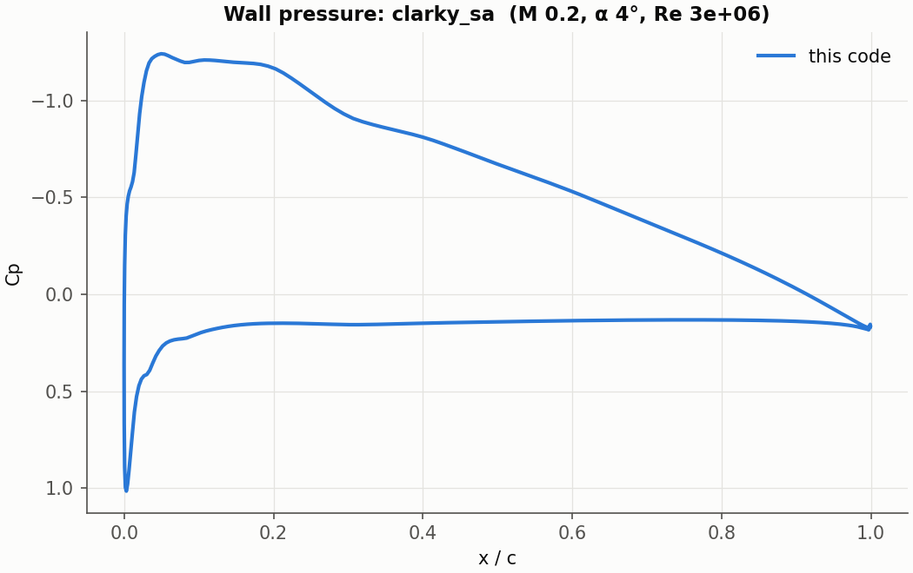

# Your own airfoil

This page takes a coordinate file you downloaded or exported and runs it.
The worked example is `examples/clarky_sa`: the Clark Y file from the
[UIUC database](https://m-selig.ae.illinois.edu/ads/coord_database.html),
used exactly as downloaded.

## 1. The coordinate file

Put the file in a new directory, next to where `case.json` will go:

```
my_airfoil/
    clarky.dat
    case.json
    numerical.json
```

The reader accepts the usual formats:

- **Selig**: a name line, then x y pairs going round the airfoil.
- **Lednicer**: a name line, a line with the point counts of the two
  surfaces, then the upper and the lower surface, each from the leading edge.
- **Plain**: two columns, no header.

Either direction round the contour is fine, and commas are read as spaces.
The airfoil is scaled to unit chord, with its leading edge at the origin.
That way a file in millimetres or a file offset from the origin give the
same grid and the same coefficients as one in chords. Nothing is rotated: set
the incidence with `alpha_deg`.

Most downloaded files have a slightly open trailing edge (0.1 to 0.3 % of
the chord). A C-grid needs a sharp one, so add `"trailing_edge": "close"`.
This moves each surface by a small amount that grows linearly from zero at
the leading edge to half the gap at the trailing edge. If you want to keep
the blunt base, use an O-grid instead.

## 2. case.json

```json
{
    "general": {"case_name": "clarky_sa"},
    "domain": {
        "grid": "c_grid",
        "airfoil": "clarky.dat",
        "trailing_edge": "close",
        "cells_airfoil": 256,
        "cells_wake": 64,
        "cells_normal": 96,
        "wall_spacing": 5e-6
    },
    "freestream": {"mach": 0.2, "alpha_deg": 4.0, "reynolds": 3e6, "temperature": 288.15},
    "material_properties": {"dynamic_viscosity": "sutherland", "sutherland_temperature": 110.4},
    "turbulence": {"model": "sa_noft2"}
}
```

The generated grid has two patches, `wall` and `farfield`. With a Reynolds
number set, the wall defaults to no-slip and the far field to the
characteristic condition, so `boundary_conditions` can be left out.

**Which grid.** A C-grid for viscous flow round a sharp trailing edge; an
O-grid for inviscid flow, or to keep a blunt trailing edge.

**How many cells.** For RANS, 256 round the airfoil, 64 along the wake and
96 to 128 outward is a reasonable first grid (40 to 50 thousand cells).
Double `cells_airfoil`, `cells_wake` and `cells_normal` and halve
`wall_spacing` to see how much the answer still depends on the grid.

**Wall spacing.** For RANS the first cell should sit at y+ of about 1. A flat
plate estimate, in chords:

```python
re = 3e6
cf = 0.026 / re ** (1 / 7)                  # turbulent flat plate skin friction
wall_spacing = 1 / (re * (cf / 2) ** 0.5) / 2   # y+ = 1, halved for the suction peak
print(wall_spacing)                         # 4.3e-06
```

For laminar flow it is the boundary layer you need to resolve: aim for about
30 cells across it (the laminar example uses 1e-4 at Re 5000).

**Far field.** The default of 100 chords is safe. To bring it closer, add
the point-vortex correction, which accounts for the lift's far-field
signature:
`"boundary_conditions": {"farfield": {"type": "far_field", "model": "point_vortex"}}`.
The RAE 2822 validation grid uses it with its boundary 20 to 38 chords away.

## 3. numerical.json

```json
{
    "convective_fluxes": {"limiter": "none"},
    "time_integration": {"solver": "implicit"},
    "implicit": {"max_relative_update": 0.2},
    "convergence": {"max_iters": 3000}
}
```

Use the implicit solver for any viscous case. The limiter: `none` for
subsonic flow without shocks, `van_albada` for transonic RANS or high lift,
`minmod` for inviscid shocks. `max_relative_update` keeps the first few
hundred SA steps from overshooting.

## 4. Check the grid, then run

```bash
jaxaero my_airfoil --check
```

This builds the grid, prints the quality report and the patches, and
writes `results/clarky_sa/grid.png`. It does not solve anything. For the
Clark Y:

```
grid c_grid round clarky.dat: 256 + 2x64 wake x 96 cells, wall spacing 5e-06, far field 100; trailing-edge gap 0.0012 closed: ...
grid quality: 36864 cells, min area 9.74e-09, min angle 86.7 deg, max growth 1.24, max aspect 2.61e+06; wall: first cell 4.72e-06..5.11e-06, within 3.1 deg of orthogonal; far field >= 99.8 from the walls
patch 'wall': no_slip_wall, 256 faces
patch 'farfield': far_field, 576 faces
body 0: x -0.0000 to 1.0000, y -0.0302 to 0.0914, 256 wall faces
```

A grid with folded cells (negative area) is refused. Warnings follow the
report when cells are skewed below 20 degrees or grow by more than 1.5
between neighbours. These are worth fixing, usually with more cells or a
smaller `leading_edge_spacing` / `trailing_edge_spacing`, but the case still
runs.

Then run it:

```bash
jaxaero my_airfoil
python -m jaxaero.plot my_airfoil/results/clarky_sa
```

On a 4 GB laptop GPU the Clark Y takes 25 minutes for 3000
iterations (0.46 s each; an A100 is several times faster). The residual
drops 8 orders, and CL stops changing after about 1500 iterations:

```
CL = +0.801203   CD = +0.011022 (friction +0.007529)   CM = -0.075397
```

The drag is for a fully turbulent boundary layer: SA has no transition
model, so expect more drag than a wind tunnel at this Reynolds number.



The small bumps near the leading edge are in the coordinate file, not the
flow. The file has 61 points per surface with four or five digits, and its
curvature jumps between neighbouring points (on the upper surface at x/c
0.02, 0.08 and 0.16). The solver follows the geometry it is given. If you
see this in your own results, use a file with more points, or smooth it
before running.

## 5. Is it converged?

The log ends with the number of orders the residual dropped from its peak,
and the lift is printed every block. Take the answer when the residual has
dropped five or more orders and CL has stopped changing in the digits you
care about. If it stalls, raise `max_iters` first. A stall at two or three
orders with an oscillating CL usually means a separated or unsteady flow,
or a grid that is too coarse at the trailing edge.

## 6. A polar

```bash
python -m jaxaero.polar my_airfoil --alpha -4 12 2
```

This runs every angle together (on a GPU, as one batch) and writes
`polar.dat`, with one row per angle: alpha, CL, CD, friction drag, CM, the
orders the residual dropped, the iterations, the spread of CL over the last
quarter of the run, and whether that spread is small enough to call CL
settled. `python -m jaxaero.plot` on the polar directory draws it. Near and
past stall, look at the `settled` column: a steady solver cannot settle a
flow that is really unsteady.

## Changing one thing without editing the files

```bash
jaxaero my_airfoil --set case.freestream.alpha_deg=8 --set case.domain.cells_normal=128
```

The changed values are saved with the result.
