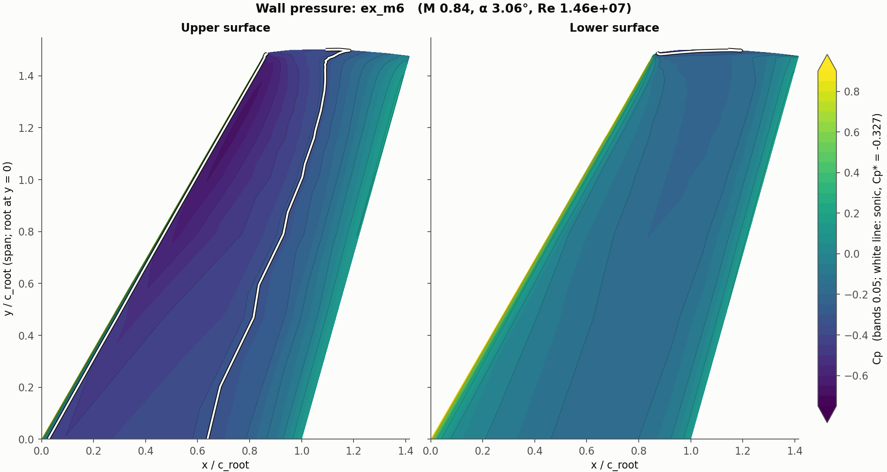

# A 3D wing

The solver runs 3D grids with the same two JSON files as 2D: the dimension is
the grid's. It does not generate 3D grids: make a structured grid with your
mesher and point the case at the file. The worked example is
`examples/onera_m6_sa`, the ONERA M6 wing at NASA's Turbulence Modeling
Resource conditions (case 2308), on a small grid that ships with the example.

## 1. What the grid file must be

- **Format**: Plot3D with three index directions (formatted or binary, single
  or double precision). CGNS is read in 2D only for now.
- **One block.** Multi-block 3D grids are not supported yet.
- **What lies on each of its six sides** is found from the coordinates:
    - two opposite sides whose nodes coincide become an interface (the seam of
      an O-grid round the wing section);
    - a side collapsed to a line (every face of zero area) becomes a **pole**,
      provided it lies round a seam direction with an even number of cells.
      The rounded tip of the example grid closes this way;
    - every other face is named by the box rules of `domain.patches`
      (section 2).
- **Axes**: `x` along the chord, `y` along the span, `z` up. The angle of
  attack turns the freestream in the `x`-`z` plane.
- **The wall-normal index should be `j`.** The implicit solver's
  preconditioner solves along `j` lines, which is what makes thin wall cells
  affordable. A wall on another index has not been tested.
- A block that is left-handed is reversed in `k` on reading. A folded grid
  (a cell of non-positive volume) is refused.

A half model with the root on a symmetry plane, as in the example, is the
usual set-up.

## 2. case.json

```json
{
    "general": {"case_name": "onera_m6_sa"},
    "domain": {
        "grid": "file",
        "file": "om6_strct_16x44x24.ufmt",
        "patches": [
            {"name": "symmetry", "y_max": 1e-9},
            {"name": "wall", "x_min": -1.0, "x_max": 3.0, "y_max": 3.0, "z_min": -1.0, "z_max": 1.0},
            {"name": "farfield"}
        ],
        "reference_area": 1.15315084119,
        "reference_length": 0.8016729585,
        "moment_centre": [0.0, 0.0, 0.0]
    },
    "boundary_conditions": {
        "wall": {"type": "no_slip_wall"},
        "farfield": {"type": "far_field"},
        "symmetry": {"type": "symmetry"}
    },
    "freestream": {"mach": 0.84, "alpha_deg": 3.06, "reynolds": 14.6e6, "temperature": 540.0},
    "material_properties": {"dynamic_viscosity": "sutherland", "sutherland_temperature": 198.6},
    "turbulence": {"model": "sa_noft2"}
}
```

**Patches.** A Plot3D file has no boundary names, so each boundary face takes
the name of the first rule whose box contains its midpoint; a bound left out
is unbounded. Here the root plane `y = 0` is `symmetry`, the faces inside a
box round the wing are `wall`, and the last rule, with no bounds, takes
everything left: the far field. A face that matches no rule is an error, so
end with a rule without bounds.

**Reference values.** `reference_area` is required in 3D: lift, drag and side
force are per `q_inf * reference_area`. For a half model give the half
model's area. `reference_length` and `moment_centre` are for the pitching
moment: about the `y` axis through `moment_centre`, nose-up positive, per
`q_inf * reference_area * reference_length`, pressure and friction together.

**Reynolds number.** Per unit length of the grid. The example grid has a root
chord of 1, so 14.6e6 is the Reynolds number per root chord. Use
`coordinate_scale` if your grid is in other units.

For Euler, leave out `reynolds`, `material_properties` and `turbulence` and
make the wall a `slip_wall`.

## 3. numerical.json

```json
{
    "convective_fluxes": {"riemann_solver": "hllc", "limiter": "van_albada"},
    "time_integration": {"solver": "implicit"},
    "implicit": {"max_relative_update": 0.2},
    "convergence": {"max_iters": 1500, "tol": 1e-12, "block_iters": 20}
}
```

`van_albada` is the robust choice with a shock. On coarse grids it costs
accuracy: on the 135,168-cell level of this wing it gave a drag 21% above
NASA's CFL3D on the same grid. CFL3D runs this case without a limiter and with
the third-order upwind-biased reconstruction, which here is

```json
"convective_fluxes": {"riemann_solver": "hllc", "limiter": "none", "muscl_kappa": 0.3333333333333333}
```

With it the same level is within 5.6% in drag and 0.8% in lift, and the
1,081,344-cell level within 1.74% and 0.19%. Without a limiter the residual
can stall at a few orders while the forces are steady; judge by the forces.

## 4. Check the grid

```bash
jaxaero examples/onera_m6_sa --check
```

```
grid file om6_strct_16x44x24.ufmt: 1 block(s), 16896 cells, 1 body(ies); implicit, hllc, limiter van_albada
grid quality: 16896 cells, min area 1.84e-11, min angle 4.3 deg, max growth 5.42, ...; far field >= 98.3 from the walls
patch 'wall': no_slip_wall, 384 faces
patch 'farfield': far_field, 384 faces
patch 'symmetry': symmetry, 1056 faces
wall: 384 faces, x 0.0000 to 1.4147, y -0.0000 to 1.5012, z -0.0460 to 0.0460
```

Check that every patch you expect is there with a plausible number of faces,
and that the wall's extent is the wing's, in the units of your Reynolds
number. A seam or a pole does not appear: only the faces left for the rules
do. (The skewness and growth warnings here come from this very coarse level
at the tip.) There is no grid picture in 3D.

## 5. Run

```bash
jaxaero examples/onera_m6_sa
```

```
     300  res 1.1982e-05 ( 1.05 orders)  CL = +0.231714   CD = +0.039755 (friction +0.005711)   CM = -0.175003   CY = +0.000908
     600  res 7.6234e-10 ( 5.25 orders)  CL = +0.221072   CD = +0.038973 (friction +0.005306)   CM = -0.163561   CY = +0.000664
    1500  res 1.1421e-13 ( 9.07 orders)  CL = +0.221072   CD = +0.038973 (friction +0.005306)   CM = -0.163561   CY = +0.000664
```

Eight minutes on a laptop GPU (4 GB), 0.27 s per step; the forces are steady
from step 600. `CY` is the side force. This level is far too coarse for the
values to mean much (NASA's finest grids give CL 0.2693, CD 0.01696): it is
there to try the workflow.

The result directory holds:

| file | content |
|---|---|
| `*_surface.dat` | one row per wall face: its indices `i k` on the wall, `x y z`, `cp`, and the skin-friction vector `cf_x cf_y cf_z` |
| `*_block0.vts` | the whole field for [ParaView](https://www.paraview.org): density, velocity, pressure, Mach number per cell |
| `*_fields.npz` | the conservative state and the grid nodes |
| `*_residual.dat`, `*_lift.dat`, `*_metadata.json` | histories, the resolved case and provenance |

`python -m jaxaero.plot` draws 2D results only. For a wing,
`python scripts/plot_wing.py RESULT_DIR` draws the pressure on the upper and
lower surfaces, with the sonic line, and a 3D view:



(The script assumes the layout of this grid family: the wall on `j = 0`, `i`
along the span, `k` round the section from the leading edge.)

## 6. Cost

Measured on this wing, per implicit step:

| cells | GPU | Euler | SA |
|---|---|---|---|
| 16,896 | laptop, 4 GB | 0.23 s | 0.27 s |
| 135,168 | A100 / V100 | 0.12 s / 0.29 s | — / 0.34 s |
| 1,081,344 | A100 | 0.86 s | 1.32 s |

Forces are steady after roughly 600 to 2500 steps, more on finer grids. The
run stops there by itself (`settled`: CL, CD and CM each vary by less than
`convergence.forces_tol`, 1e-4, over the last quarter of the iterations), or
at `tol` or `max_iters`, whichever comes first; results are written at the
end.

On a fine grid, `"convergence": {"grid_sequencing": 1}` (or 2, ...) solves first
on the grid with every other node, and starts the case's grid from that
solution: on the 1,081,344-cell level the forces settle within 1e-4 of their
final values 2.8x sooner in fine-grid steps (620 against 1760). Every cell
count, and every patch and interface limit, must stay even.

## 7. Finer grids of the example

NASA does not ship the ONERA M6 grids but the program that makes them.
`data/grids/README.md` gives the recipe (two Fortran files, a few minutes) and
the names of the levels: 135,168 and 1,081,344 cells are the ones NASA's
reference results are quoted on. Point `domain.file` at a level, or

```bash
jaxaero examples/onera_m6_sa --set case.domain.file=data/grids/onera_m6/om6_strct_32x88x48.ufmt
```

## 8. Limits

- One block, Plot3D. No 3D grid generation, no multi-block 3D, no CGNS in 3D.
- `python -m jaxaero.plot` and the `--check` picture are 2D only.
- Polars (`python -m jaxaero.polar`) have not been tested in 3D.
- The far field is plain characteristic (no point-vortex correction in 3D):
  put it far away, as here (100 chords).
